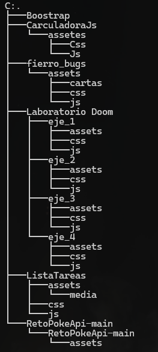

# Portafolio de proyectos  ADSO 

## Contenidos

- **Carculadora**
- **Fierro**
- **Administrador de Tareas**
- **Consumo PokeApi**
---
## Estructura

---
### Clonar : 
`
Git Clone https://github.com/Bhusvnash/ADSO.git
`
## Proyectos 

- **Carculadora**: Calculadora en Javascript con soporte para operaciones basicas, calculo de Indice de Masa Corporal (IMC) y conversion de temperatura.
- **Fierro**: Juego de cartas Blackjack donde el usuario puede jugar contra la computadora.
- **Administrador de Tareas**: Gestor de tareas orientado a objetos que permite agregar actividades, ajustar su prioridad y filtrar las tareas pendientes.
- **Consumo PokeApi**: Aplicacion web interactiva que consume la API publica de Pokemon para buscar y mostrar sus detalles.